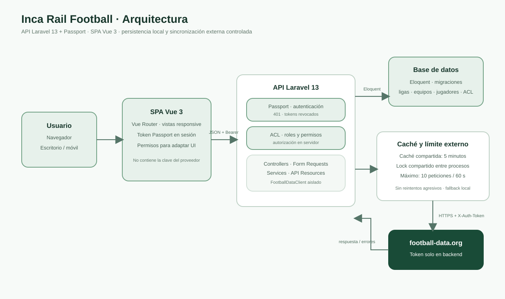

# Inca Rail Football Platform

API REST en Laravel y SPA Vue para consultar competiciones, equipos y jugadores de fútbol, conservar localmente los datos consultados y controlar el acceso mediante usuarios, roles y permisos.

## Stack

- PHP 8.5 y Laravel 13 con Laravel Passport.
- Vue 3 y Vue Router.
- SQLite por defecto (compatible con Eloquent).
- football-data.org v4, con el token guardado únicamente en el entorno backend.

## Requisitos locales

- PHP 8.5 con `ext-sodium` y PDO SQLite habilitados, además de las extensiones requeridas por Laravel.
- Composer 2.
- Node.js 22 y npm.

Confirma las extensiones antes de instalar:

```powershell
php -v
php -m | Select-String 'sodium|PDO|pdo_sqlite|sqlite3'
```

Debe aparecer PHP 8.5 y los módulos `sodium`, `PDO`, `pdo_sqlite` y `sqlite3`.
Después de instalar PHP o cambiar el `PATH`, abre una terminal nueva para que cargue la configuración del usuario.

## Instalación desde cero

La configuración predeterminada usa SQLite, por lo que no hace falta instalar un servidor de base de datos. Desde PowerShell, en la raíz del proyecto:

```powershell
Set-Location .\backend
composer install
Copy-Item .env.example .env
if (-not (Test-Path .\database\database.sqlite)) { New-Item -ItemType File .\database\database.sqlite | Out-Null }
php artisan key:generate
php artisan migrate --seed
New-Item -ItemType Directory -Force .\storage\oauth | Out-Null
php artisan passport:keys
php artisan passport:client --personal --name="Personal Access Client"
```

En `backend/.env`, configura el proveedor:

```dotenv
FOOTBALL_DATA_BASE_URL=https://api.football-data.org/v4
FOOTBALL_DATA_TOKEN=
```

Guarda tu token real únicamente en `backend/.env`; no lo envíes al chat, no lo agregues al frontend y nunca lo pongas en `.env.example`.

Passport se inicializa una vez por entorno limpio. Conserva la base de datos y las claves generadas si reinicias el servidor. No vuelvas a ejecutar `passport:keys` ni crees otro cliente cada vez que inicies la app.

## Ejecución

En una terminal:

```powershell
Set-Location .\backend
php artisan serve --host=127.0.0.1 --port=8000
```

En otra terminal:

```powershell
Set-Location .\frontend
npm install
Copy-Item .env.example .env.local
npm run dev
```

Abre la URL que informe Vite (por defecto `http://localhost:5173`). El proxy del servidor de desarrollo reenvía `/api` a `http://127.0.0.1:8000`. Si el API se sirve en otro origen, cambia `VITE_API_BASE_URL` y configura `FRONTEND_URL` en el backend.

## Usuarios de prueba

| Usuario | Contraseña local | Rol | Acceso |
|---|---|---|---|
| `admin@inca-rail.test` | `IncaRail2026!` | Administrador | Administra usuarios, roles y permisos; consulta e importa competiciones. |
| `reader@inca-rail.test` | `IncaRail2026!` | Solo consulta | Consulta competiciones, equipos y jugadores locales; no administra ni dispara importaciones. |

Son credenciales ficticias para desarrollo. Cámbialas o elimina las cuentas sembradas antes de cualquier despliegue.

## Arquitectura

### Diagrama de componentes



La SPA usa Passport para autenticarse contra Laravel. La API autoriza en servidor y persiste con Eloquent; las llamadas externas pasan por caché y un limitador coordinado que protege el máximo de diez solicitudes por minuto. La fuente editable del diagrama está en [docs/arquitectura.mmd](docs/arquitectura.mmd).

Más información: [arquitectura](docs/02-arquitectura.md), [modelo de datos](docs/04-modelo-de-datos.md), [contrato de API](docs/05-api-rest.md), [seguridad](docs/06-seguridad-y-permisos.md), [integración externa](docs/07-integracion-football-data.md) y [frontend](docs/08-frontend.md).

## API y datos locales

Todas las rutas salvo `POST /api/login` requieren un token de acceso de Passport. Rutas principales:

- `GET /api/competitions`: muestra las competiciones habilitadas en la suscripción de football-data.org; el catálogo remoto se cachea cinco minutos.
- `GET /api/competitions/{id}`: importa competición, equipos y plantillas cuando la cuenta tiene `competitions.import`; usuarios de solo consulta reciben únicamente datos guardados localmente.
- `GET /api/team` y `GET /api/team/{id}`: consultan datos locales.
- `GET /api/players` y `GET /api/players/{id}`: consultan jugadores guardados localmente.
- `GET /api/me`: devuelve el perfil con permisos efectivos.
- Rutas `/api/users`, `/api/roles` y `/api/permissions`: operaciones ACL sujetas a permisos del servidor.

Las consultas de equipos y jugadores no llaman al proveedor. Al fallar football-data.org, una consulta con datos locales devuelve esa copia e incluye una advertencia; si no hay copia local y el proveedor limita o falla, se devuelve el código HTTP 429 o 503 correspondiente. Los errores API usan la forma `error.code`, `error.message` y `error.details`.

## Cuota de football-data.org

Las respuestas externas se cachean cinco minutos. Un lock por recurso evita duplicar solicitudes simultáneas a la misma URL; un segundo lock compartido serializa solo la reserva de cuota antes de cada llamada HTTP. Así, distintas URLs pueden consultarse en paralelo sin competir sobre el mismo contador. El contador y ambos tipos de lock usan el mismo cache store. En esta configuración local `CACHE_STORE=database`; en producción con varias instancias, usa un store compartido como Redis. No hay reintentos automáticos. El detalle de una competición puede consumir dos solicitudes si no hay respuesta en caché (competición y equipos), ambas se contabilizan.

`php artisan test` verifica el límite tras diez llamadas sin caché y `CompetitionImportTest` verifica la importación con respuestas simuladas. La prueba no es una prueba de estrés de workers concurrentes; el límite global depende de que todos compartan el mismo cache store.

## Pruebas y build

Desde `backend/`:

```powershell
php artisan test
```

Desde `frontend/`:

```powershell
npm run build
```

## Decisiones, supuestos y pendientes

- Se usa arquitectura por capas pragmática: controladores, validación, Resources, servicios, Eloquent y un cliente dedicado al proveedor, sin adoptar opcionales que no aportan valor claro a este alcance.
- El token de Passport se guarda en `sessionStorage` y se elimina al cerrar sesión, expirar o cerrar la pestaña. No se guarda la contraseña ni el token externo. `sessionStorage` no protege frente a XSS; producción requiere HTTPS y una evaluación adicional del modelo de sesión.
- La instalación del backend y frontend se verificó desde copias limpias siguiendo los pasos de este README.
- El limitador reserva cuota con locks compartidos y está probado con solicitudes repetidas; queda pendiente un test de estrés real entre varios workers.
- Rotar en football-data.org el token que anteriormente estuvo en `.env.example`; el archivo actual está vacío, pero la rotación no puede hacerse desde el proyecto.
- Revisar el historial Git para confirmar que el token del proveedor no quedó en commits previos. El directorio de trabajo usado para esta revisión no contiene `.git`, así que no se pudo inspeccionar el historial.
- Completar la entrega por un solo correo con el enlace al repositorio, dentro del plazo de la prueba.
