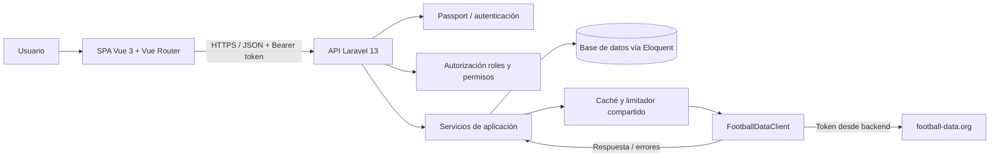

# 02. Arquitectura implementada

## Enfoque

La aplicación usa una arquitectura por capas pragmática: controladores HTTP, Form Requests, API Resources, servicios de aplicación, modelos Eloquent y un cliente HTTP dedicado para football-data.org. Las consultas locales leen Eloquent directamente; `CompetitionSyncService` coordina la sincronización idempotente.

## Componentes

- **SPA Vue 3:** interfaz, navegación, formularios y vistas.
- **API Laravel:** valida solicitudes, autentica usuarios, autoriza operaciones y expone JSON.
- **Laravel Passport:** emisión y revocación de tokens de acceso.
- **Servicios de aplicación:** `CompetitionSyncService` persiste la competición, sus equipos y jugadores dentro de una transacción.
- **Cliente FootballDataClient:** único componente que conoce la URL, cabeceras y respuestas del proveedor.
- **Base de datos:** copia local de competiciones, equipos, jugadores y ACL.
- **Caché/limitador:** cachea respuestas por cinco minutos, evita llamadas simultáneas duplicadas por URL y reserva cada llamada con un contador protegido por lock compartido.

## Diagrama lógico (Mermaid)

El diagrama vectorial entregable está en `docs/arquitectura.svg`; su fuente editable está en `docs/arquitectura.mmd`.

## Flujo de consulta local

1. Vue envía una solicitud autenticada a Laravel.
2. Laravel valida token y permiso.
3. El controlador consulta la base de datos y sus relaciones mediante Eloquent.
4. La API responde con un Resource JSON.
5. La consulta local no llama al proveedor.

## Flujo de importación de competición

1. El usuario autorizado solicita el detalle de una competición.
2. Laravel verifica permisos y la disponibilidad de cuota/caché.
3. El cliente aislado llama a football-data.org cuando sea necesario.
4. El servicio valida y transforma la respuesta.
5. Se guardan competición, equipos y jugadores en una transacción cuando corresponda.
6. Las restricciones únicas y la estrategia de actualización evitan duplicados.
7. La API devuelve el detalle/importación y registra el resultado operativo sin exponer secretos.

## Límite de peticiones

El proveedor tiene un límite de 10 peticiones por minuto según el enunciado. `FootballDataClient` incrementa el contador global dentro de un lock del cache store antes de cada llamada HTTP; solo esa sección corta se serializa, de modo que URLs distintas pueden consultarse en paralelo. Un lock por URL evita duplicar solicitudes simultáneas y vuelve a revisar la caché una vez adquirido. La garantía entre procesos requiere que todos los workers usen el mismo cache store compartido (`database` localmente, Redis u otro store compartido en despliegues multiinstancia).

## Errores y observabilidad

- Normaliza errores del proveedor a un formato JSON común.
- Distingue error de autenticación, autorización, validación, recurso inexistente y fallo externo.
- Registra estado, duración y tipo de fallo sin guardar tokens ni datos sensibles.
- Evita reintentos inmediatos en caso de cuota agotada.
