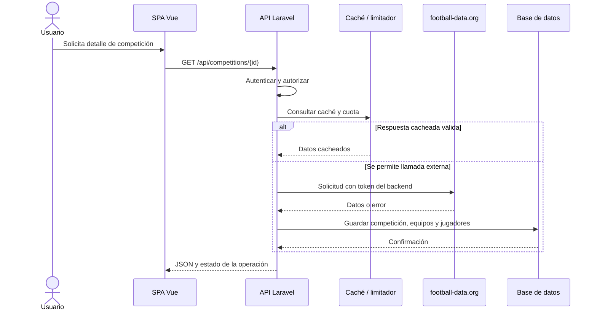

# 07. Integración con football-data.org

## Objetivo

Consultar el proveedor externo y conservar una copia local, evitando que las consultas locales dependan de la disponibilidad del proveedor. El enunciado indica un límite de 10 peticiones por minuto para el token gratuito.

## Aislamiento del proveedor

Centraliza toda comunicación externa en una clase, por ejemplo `FootballDataClient`. Esta clase es responsable de:

- Construir solicitudes HTTP y añadir el token desde el entorno.
- Enviar la credencial del proveedor en la cabecera `X-Auth-Token`, nunca en el navegador.
- Consultar `GET /competitions/{id}/teams` para obtener los equipos y las plantillas; la respuesta de `GET /competitions/{id}` solo contiene los datos de la competición.
- Aplicar timeout.
- Interpretar códigos HTTP y errores de red.
- Devolver datos normalizados o errores tipados al servicio de aplicación.
- No persistir directamente entidades mediante lógica duplicada en varios controladores.

El nombre y la ubicación exacta de la clase pueden ajustarse al código real.

## Estrategia recomendada

1. **Datos locales primero para consultas locales.** `/team`, `/team/{team_id}` y `/players` deben consultar la base de datos.
2. **Caché de respuestas externas.** Cachear temporalmente listados o detalles cuando sea seguro hacerlo y definir su duración.
3. **Importación idempotente.** La misma competición consultada repetidamente no debe duplicar equipos ni jugadores.
4. **Limitador compartido.** Controlar el número de llamadas por minuto mediante un mecanismo atómico compartido entre procesos. Un contador en memoria de un único proceso no basta en despliegues con varios workers.
5. **Concurrencia.** Evitar que varias solicitudes simultáneas importen la misma competición o gasten cuota de forma redundante; usar locks o una cola si se adopta esa arquitectura.
6. **Persistencia consistente.** Transformar y validar datos antes de guardarlos; usar transacción donde corresponda.
7. **Reintentos conservadores.** No repetir rápidamente una llamada cuando el proveedor indica que se agotó la cuota.

El listado remoto se cachea cinco minutos y se usa para mostrar únicamente las competiciones disponibles para la suscripción configurada. Un lock por recurso serializa las peticiones simultáneas a la misma URL y vuelve a consultar la caché después de adquirirlo, evitando llamadas duplicadas. Un lock de corta duración serializa la reserva del contador global, pero se libera antes de la llamada HTTP para permitir peticiones paralelas a URLs distintas sin exceder la cuota. Contador, caché y locks usan el mismo cache store, por lo que todos los workers deben compartirlo. Con la configuración local `CACHE_STORE=database`, este estado se comparte mediante la base de datos; en despliegues multiinstancia debe configurarse un store compartido, por ejemplo Redis.

Si el proveedor no responde, la API conserva y devuelve los datos locales que ya existen con `meta.source=local` y `meta.warning`. Si no existe una copia local que pueda responder, devuelve HTTP 429 por cuota excedida o 503 por fallo temporal. El detalle autorizado puede hacer dos solicitudes externas (competición y equipos), ambas protegidas por el mismo contador. La caché reduce llamadas repetidas; no hay reintentos automáticos.

## Flujo de importación propuesto



## Tratamiento de errores

- **Timeout o fallo de red:** devolver error normalizado; no borrar datos locales.
- **Cuota del proveedor agotada:** no reintentar en bucle; devolver un mensaje claro y, cuando proceda, información local previamente guardada.
- **Proveedor no disponible:** responder con 503; cuando el proveedor o el limitador indiquen cuota excedida, responder con 429.
- **Datos externos inesperados:** validar estructura antes de persistir; no asumir que todos los campos están presentes.
- **Competición no encontrada:** mapear la respuesta externa apropiadamente y evitar confundirla con un error interno.

## Contrato y mensajes

La API local debe distinguir entre un fallo de importación y una consulta exitosa a datos guardados. Si se devuelve información local desactualizada, indicar claramente su condición y la fecha de última sincronización cuando exista.

## Variables de entorno

```dotenv
FOOTBALL_DATA_BASE_URL=https://api.football-data.org/v4
FOOTBALL_DATA_TOKEN=
```

El token real nunca debe incluirse en Git ni en el bundle de Vue.

## Qué documentar en el README

- Mecanismo concreto de caché y duración.
- Cómo se garantiza el límite con solicitudes concurrentes.
- Qué ocurre si el cupo se agota.
- Qué datos se persisten y cómo se evitan duplicados.
- Cómo probar errores del proveedor sin depender de llamadas reales, usando mocks en pruebas.
